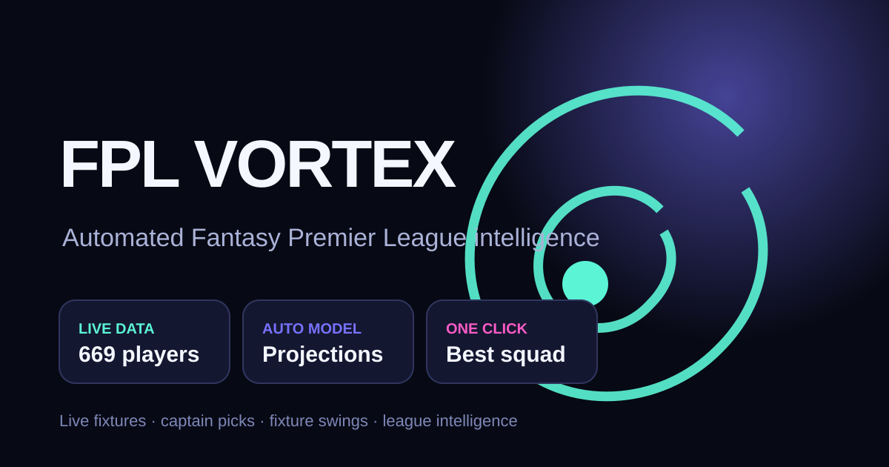

# FPL VORTEX

<p align="center">
  
</p>

**FPL VORTEX** is an automated Fantasy Premier League intelligence platform built on official public FPL endpoints, repository benchmark archives, and a zero-dependency TypeScript projection and squad optimization engine.

It turns live FPL player, club, fixture, and scoring feeds into explainable next-gameweek projections, captaincy leverage, fixture-swing heatmaps, FPL-legal squad builds, public team/league scans, and `@FPLVORTEX` channel briefings — with automatic memory caching and offline snapshot fallback.

---

## Key Capabilities

- **Command Center (`/#/command`)** — Live deadline countdown, adaptive refresh status, projected points leaderboard with 9-point SVG sparklines, captaincy leverage rings, schedule swings, and transfer momentum.
- **Squad Optimizer (`/#/optimizer`)** — Beam-search Best XV builder across four strategy profiles (`Balanced`, `Safe`, `Differential`, `Upside`) enforcing all official 2026/27 FPL constraints (`15` players, `2/5/5/3` structure, max `3` per club, budget cap, legal `11`-player formation, captain/vice-captain, ordered bench, and lockable players).
- **Player Lab (`/#/players`)** — Searchable, filterable, CSV-exportable universe of all Premier League players with FDR-5 ratings, confidence bars, repository `xMins` / 5-GW `xPts` benchmarks, and explainable player modals.
- **Fixture Matrix (`/#/fixtures`)** — 5-gameweek club difficulty heatmap with Blank (`BLK`) and Double (`2×`) indicators, schedule swing rankings, club asset spotlight, and CSV export.
- **League Intel (`/#/league`)** — Passwordless public FPL team (`5112705`, `145784`, or any numeric entry ID) and classic league (`314` or any classic league ID) scanner with 15-player squad projection, one-move transfer upgrades, and live/offline standings.
- **Model & Automation (`/#/method`)** — Full transparency into system health, projection weights, 2026/27 season rules, upstream feeds, `@FPLVORTEX` video briefings, and resilience architecture.

---

## Quick Start

Requires **Node.js 20.19+** (22 LTS recommended).

```bash
npm ci
npm run dev
```

Open `http://localhost:3000`. Both the Vite React frontend and Express API run on the same origin.

### Verification & Production Build

```bash
npm run typecheck    # TypeScript strict check across src, server, scripts, tests
npm test             # Node test suite (normalization, analytics, fixtures, optimizer, repo data)
npm run build        # Production client bundle into dist/
npm run preview      # Production Express server on 0.0.0.0:3000
```

### Refreshing the Offline Snapshot

```bash
npm run data:refresh
```

---

## Architecture & Resilience Chain

```text
Official FPL API (/bootstrap-static, /fixtures, /event/{id}/live, /entry/{id}, /leagues-classic/{id})
   ↓
Express Server (server/index.ts, server/fpl.ts, server/normalize.ts, server/repoData.ts)
   ├─ Tier 1: Live official FPL API (45s TTL during live scoring · 10m TTL between deadlines)
   ├─ Tier 2: Last-good normalized in-memory cache (stale-while-revalidate)
   ├─ Tier 3: Committed offline snapshots (public/data/fpl-snapshot.json & public/data/fpl-league-fallback.json)
   └─ Primary Repository Enrichment:
        • 3_data_third_party/fplcopilot-projections-gw7-2026-10-15-v4.csv (667 player xMins & xPts)
        • site/ui/videos.json + live YouTube RSS (@FPLVORTEX channel UCDU7nEIN72xoiR3NtxCT6CQ)
        • 2026/27 official FPL rules (5 banked free transfers, GW19 chip-half split)
   ↓
React 19 + Vite 6 + Brand Kit Design System (brand-kit/design-tokens.css, self-hosted Inter Variable)
```

### API Endpoints

| Method | Path | Description |
| --- | --- | --- |
| `GET` | `/api/health` | Service health, cache source (`live` / `cache` / `snapshot`), season rules, and repository metadata |
| `GET` | `/api/vortex/snapshot` | Full normalized FPL universe enriched with repository `xMins` / `xPts` benchmarks |
| `POST` | `/api/vortex/refresh` | Rate-limited manual upstream refresh |
| `GET` | `/api/vortex/entry/:id` | Public FPL manager entry, GW picks, squad value, and projected points (with offline fallback) |
| `GET` | `/api/vortex/league/:id` | Public classic league standings and rank movement (with offline fallback) |
| `GET` | `/api/vortex/videos` | `@FPLVORTEX` channel video briefings (live YouTube RSS → `site/ui/videos.json`) |
| `GET` | `/api/vortex/benchmarks` | Repository multi-GW `xMins` & `xPts` benchmark table (`?gw=9`) |

Compatibility aliases (`/api/status`, `/api/videos`, `/api/fpl/bootstrap`, `/api/fpl/fixtures`, `/api/fpl/entry/:id`, `/api/fpl/league/:id`) are also served on the same Express router.

---

## Brand Kit & Visual Reference

All visual tokens, typography, icons, and reference baselines live in [`brand-kit/`](brand-kit/BRAND-KIT.md):

- `brand-kit/design-tokens.css` — Mint (`#5BF5D6`), Electric Violet (`#7772FF`), Neon Pink (`#FF5BC8`), Signal Blue (`#49B3FF`), Warm Amber (`#FFC66D`), dark (`#070914`) & light (`#F4F6FF`) surface tokens.
- `public/fonts/InterVariable.woff2` — Self-hosted `Inter Variable` (`100–900`) with tabular numerals.
- `brand-kit/brand-preview.html` & `brand-kit/assets/website-preview.html` — Visual spec sheet and full 6-page static parity baseline (also served at `/brand-kit/assets/website-preview.html`).

---

## Repository Directory Map

| Path | Contents |
| --- | --- |
| `src/`, `server/`, `public/`, `tests/`, `scripts/` | Unified FPL VORTEX full-stack TypeScript application |
| `brand-kit/` | Official FPL VORTEX brand guidelines, CSS design tokens, SVG marks, and visual preview baselines |
| `3_data_third_party/` | Primary multi-gameweek `xMins` and `xPts` benchmark CSV dataset (667 players) |
| `site/` | Companion static/serverless bundle & `@FPLVORTEX` verified video archive (`site/ui/videos.json`) |
| `1_APP_dashboard/` | Reference Next.js dashboard & 2026/27 season rule specifications |
| `2_notebooks/` | Monte Carlo (`V4.6`) & Wildcard/Free Hit optimization notebooks (configured entry `145784`) |
| `4_backup/` – `9_dashboard_reference/` | Historical backups, screenshots, recon docs, skills, engineering handoff reports, and references |

---

## Docker

```bash
docker compose up --build
```

---

## License & Disclaimer

MIT License. FPL VORTEX is an independent analytics tool and is not affiliated with or endorsed by the Premier League or Fantasy Premier League.
